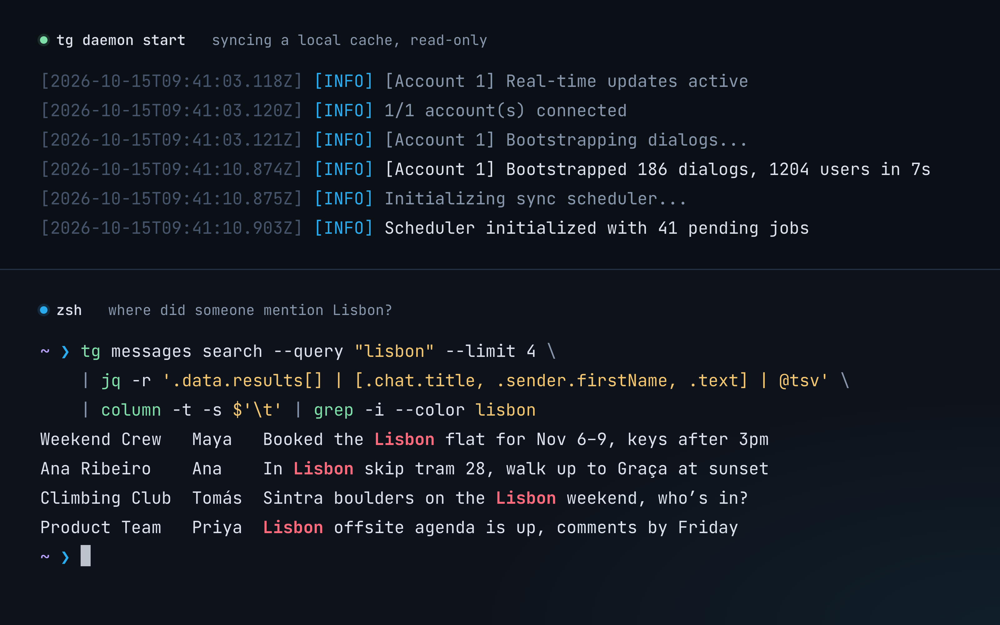

# telegram-sync-cli

Agent-friendly Telegram CLI with a local cache, a read-only sync daemon and full MTProto API access.
Website: [tg.sergeybaus.com](https://tg.sergeybaus.com).

[](https://github.com/neoromantic/telegram-sync-cli/actions/workflows/ci.yml)
[](https://www.npmjs.com/package/@goodit/telegram-sync-cli)
[](LICENSE)



## Install

With [Homebrew](https://brew.sh) on macOS or Linux, a standalone binary:

```bash
brew install neoromantic/tap/tg
```

With [Bun](https://bun.sh) >= 1.4:

```bash
bun i -g @goodit/telegram-sync-cli
```

The npm package runs the TypeScript source with Bun; nothing is compiled at install time.
`npm i -g @goodit/telegram-sync-cli` also works, as long as `bun` is on your `PATH`. Binaries
for every platform, Windows included, are attached to each
[GitHub Release](https://github.com/neoromantic/telegram-sync-cli/releases).

From source:

```bash
git clone https://github.com/neoromantic/telegram-sync-cli.git
cd telegram-sync-cli
bun install
bun run src/index.ts --help   # or: bun run build, then ./dist/tg
```

## Quickstart

```bash
# Telegram API credentials from https://my.telegram.org/apps
export TELEGRAM_API_ID=123456
export TELEGRAM_API_HASH=your_api_hash

tg auth login --phone +15551234567   # or: tg auth login-qr
tg chats list --limit 20 --format pretty
tg daemon start                      # keep the cache in sync (foreground)
tg messages search --query "hello" --format pretty
```

`tg --help` and `tg --version` work before you set any credentials. When running from source,
Bun auto-loads `.env`, so you can `cp .env.example .env` and fill it in instead.

## Features

- Multi-account management (`tg accounts`, `--account`)
- Phone and QR login (`tg auth`)
- Read-only daemon for real-time sync and history backfill that keeps the contact list current;
  catch-up and history for large groups and channels on request (`tg chats sync`); the CLI does
  all mutations (`tg send`)
- Full Telegram API access through `tg api <method>`
- Cache-first reads (stale-while-revalidate) with `--fresh` to bypass the cache
- Chat history with cursor paging (`tg messages list`) and a message in context
  (`tg messages get`), cache-first
- Full-text search (FTS5) over cached messages
- Files: send one with `tg send --file`; download a message's file into a per-account media
  cache with `tg media download` (cached files need no network, partial downloads resume);
  every message item shows its attachment (kind, name, MIME type, size)
- Contacts, chats and users (`tg contacts`, `tg chats`, `tg me`, `tg user`)
- Read-only SQL over the cache (`tg sql`) with an annotated schema
- Rate-limit tracking, config and status tooling (`tg config`, `tg status`)
- JSON output and a stable error schema for scripts and agents

## How it compares

`tg` keeps your Telegram in a local SQLite cache for offline search and SQL;
[telegram-mcp](https://github.com/chigwell/telegram-mcp) is an MCP server that makes one live call
per tool. Compared on 2026-10-21 from its README and tool list:

| Feature | tg | telegram-mcp |
|---|---|---|
| Interface | CLI, JSON output, fixed exit codes | MCP server (stdio, HTTP, SSE) |
| Agent integration | any agent with a shell | MCP clients, Claude Desktop bundle |
| Local cache, offline queries | ✅ SQLite, cache-first, `--fresh` | ❌ live calls only |
| Message search | ✅ full-text (FTS5) over cached messages | ✅ Telegram server search |
| SQL over your data | ✅ read-only `tg sql` | ❌ |
| Background sync | ✅ read-only daemon: real-time, catch-up after restarts and reconnects, history backfill; catch-up and history for large groups and channels on request (`tg chats sync`) | partial: waits for events, stores nothing |
| Any MTProto method | ✅ `tg api <method>` | ❌ fixed tool set |
| Read chat history | ✅ `tg messages list` (paging) and `tg messages get` (context), cache-first, `--fresh` | ✅ |
| Send text | ✅ replies, silent | ✅ replies, Markdown/HTML |
| Edit, delete, forward, pin | partial: via `tg api` ([#23](https://github.com/neoromantic/telegram-sync-cli/issues/23)) | ✅ |
| Send and download media | ✅ one file per message (`tg send --file`), cached downloads with resume (`tg media download`); sending albums and voice messages later | ✅ files, albums, voice, transcription |
| Wait for new messages | ❌ ([#24](https://github.com/neoromantic/telegram-sync-cli/issues/24)) | ✅ |
| Groups, channels, admin rights | partial: via `tg api` | ✅ |
| Contacts | list, search, get; the rest via `tg api` | ✅ add, import, block, export |
| Reactions, polls, drafts, scheduled, folders | partial: via `tg api` | ✅ |
| Multi-account | ✅ `--account`; one cache per account, the daemon syncs each account with its own client | ✅ |
| Guardrails for agents | partial: daemon and SQL are read-only ([#26](https://github.com/neoromantic/telegram-sync-cli/issues/26)) | ✅ read-only mode, chat allowlist |
| Install | Homebrew binary, or bun/npm with Bun | git clone + uv, pip from git, Docker |
| Runtime, license | TypeScript on Bun ([mtcute](https://mtcute.dev)), MIT | Python ([Telethon](https://docs.telethon.dev)), Apache-2.0 |

## Usage

```bash
tg <command> [options]

tg accounts list
tg contacts list --limit 50
tg chats list --limit 20
tg chats sync @examplenews          # also sync a large group or channel
tg messages list --chat @username --limit 20
tg messages get --chat @username --id 42 --context 3
tg messages search --query "hello world" --since 7d   # both words, any order
tg send --to @username --message "Hi there"
tg send --to me --file ./report.pdf --caption "Q3"
tg media download --chat me --id 42 --out ./   # into the media cache, then copied here
tg api account.checkUsername --username=myuser
tg sql --query "SELECT * FROM users_cache LIMIT 10"
tg daemon start
tg status
tg db vacuum                         # give an account cache's free space back to the disk
tg config path
```

Global options: `--format json|pretty|quiet`, `--verbose`, `--quiet`. Many commands accept
`--account` (each account has its own cache; without the flag a command uses the active
account); cache-aware commands accept `--fresh`. See `tg <command> --help`. Upgrading from 0.3
with several accounts: see [per-account caches](docs/configuration.md#upgrading-to-per-account-caches).

| Variable | Description |
|----------|-------------|
| `TELEGRAM_API_ID` | Your Telegram API ID |
| `TELEGRAM_API_HASH` | Your Telegram API hash |
| `TELEGRAM_PROXY` | Optional proxy URL for CLI and daemon connections |
| `TELEGRAM_SYNC_CLI_DATA_DIR` | Override the data directory (default `~/.telegram-sync-cli`) |
| `TELEGRAM_SYNC_CLI_TELEMETRY` | `0` turns [usage stats](#usage-stats) off |
| `DO_NOT_TRACK` | `1` turns usage stats off |
| `MTCUTE_LOG_LEVEL` | mtcute log level |
| `VERBOSE` | Verbose logging (`1`) |

For a proxy, set `TELEGRAM_PROXY=socks5://127.0.0.1:1080`. Supports `socks4://`,
`socks5://`, `http://`, `https://` and MTProxy links, with credentials in the URL.
`socks5h://` and addresses without a scheme are unsupported. See
[proxy configuration](docs/configuration.md#proxy).

Reference: [CLI commands](docs/cli-commands.md), [authentication](docs/auth.md),
[configuration](docs/configuration.md), [architecture](docs/architecture.md),
[daemon](docs/daemon.md), [sync strategy](docs/sync-strategy.md), [caching](docs/caching.md),
[database schema](docs/database-schema.md), [storage](docs/storage.md), [SQL](docs/sql.md),
[search](docs/search.md), [media](docs/media.md), [rate limiting](docs/rate-limiting.md).
Known gaps are tracked in [issues](https://github.com/neoromantic/telegram-sync-cli/issues).

## For AI agents

- Output is JSON by default. Errors look like
  `{"success": false, "error": {"code": "RATE_LIMITED", "message": "…", "details": {"method": "messages.getHistory", "wait_seconds": 30}}}`.
- Exit codes: `0` ok, `1` general error, `2` auth required, `3` invalid arguments,
  `4` network error, `5` Telegram error or rate limit, `6` account not found.
- `tg sql --query "…"` runs read-only SQL over the selected account's cache (`--account`, else
  the active account); `tg sql print-schema` prints the annotated schema.
- `tg skill manifest` prints a skill manifest, `tg skill validate` checks the environment and
  `tg skill install` writes the manifest to the default location.
- The daemon never sends or edits anything, so it is safe to leave running.
- `tg status` reports each account's cache size (`--sizes` adds each table's and the media
  cache's); `tg db vacuum` prunes old bookkeeping rows and gives free space back to the disk,
  and works while the daemon runs on a cache this version created.
- After an upgrade that changes how rows are stored, the daemon rewrites the older rows in the
  background, a little each second; `tg db migrate` finishes that without it, and `tg status`
  shows the progress. Reads work the same meanwhile.

## Usage stats

tg sends usage stats to its author: how often it runs, which commands run (the command name,
such as `chats list`, never its arguments), which errors come up, the tg version, how it was
installed, the OS and CPU, and whether a terminal, a script, an AI agent or the daemon runs it,
tied to a random install ID. A Telegram error is sent by its name only (`FLOOD_WAIT`); an error
reading the config file or a cache also carries its message, with your home folder, a data
directory you set and your user name taken out. tg never sends messages, chat or contact names,
phone numbers, account, chat or user IDs, search queries or any other argument.

Nothing is sent until tg has shown you a one-line notice (in a terminal, or to an AI agent that
runs it), and nothing from CI, tests or a source checkout. The daemon and runs from a script send
each event at most once a day. A command never waits for them: as it exits, a background copy
of tg sends its events and exits within a few seconds. Events go through usage.sergeybaus.com to
PostHog, which stores them in its US Cloud as the author's processor and sees your IP address.

Turn it off with `tg telemetry off` (it also deletes the install ID),
`TELEGRAM_SYNC_CLI_TELEMETRY=0` or `DO_NOT_TRACK=1`. `tg telemetry status` shows whether it's
on, why, and the install ID. Everything that is sent:
[usage.sergeybaus.com](https://usage.sergeybaus.com); details in
[configuration](docs/configuration.md#usage-stats).

## Contributing

See [CONTRIBUTING.md](CONTRIBUTING.md) and [AGENTS.md](AGENTS.md). Security issues:
[SECURITY.md](SECURITY.md). License: [MIT](LICENSE).
